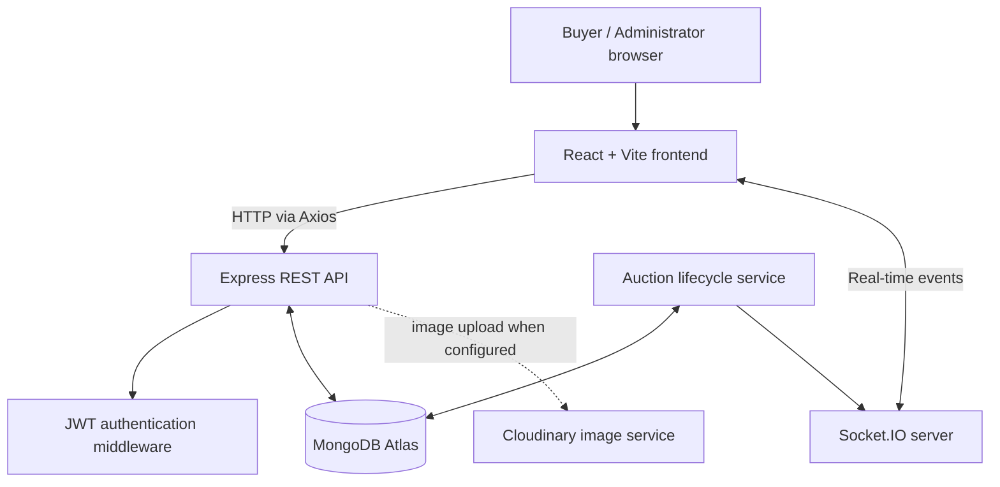

# Vutto Auctions — Architecture

## 1. Overview

Vutto Auctions is a React single-page application backed by a Node.js/Express API. MongoDB stores application data, while Socket.IO provides real-time communication between the server and connected clients.

## 2. Main components

### Frontend

- `frontend/src/main.jsx`: React entry point.
- `frontend/src/App.jsx`: main application interface and user interactions.
- `frontend/src/styles.css`: application styling.
- `frontend/src/api.js`: Axios API client and API/Socket.IO URL configuration.

The frontend uses `VITE_API_URL` and `VITE_SOCKET_URL`. These values are public configuration, not secrets.

### Backend

- `backend/src/server.js`: creates the HTTP server, attaches Socket.IO, connects to MongoDB, starts the auction lifecycle service, and listens on the configured port.
- `backend/src/app.js`: Express application setup and route/middleware registration.
- `backend/src/socket.js`: Socket.IO server setup and real-time communication.
- `backend/src/config/database.js`: database connection setup.
- `backend/src/middleware/auth.js`: authentication middleware.
- `backend/src/routes/auth.routes.js`: authentication endpoints.
- `backend/src/routes/auction.routes.js`: auction-related endpoints.
- `backend/src/services/auctionLifecycle.js`: periodic auction lifecycle processing.
- `backend/src/scripts/seedAdmin.js`: admin account seeding utility.

### Data models

- `User.js`: user/account data.
- `Auction.js`: auction data, including lifecycle and winner fields.
- `Bid.js`: bid records.

Consult the model files for exact fields, validation, and indexes.

## 3. Request and authentication flow

1. The frontend sends HTTP requests using Axios.
2. The API client attaches the stored JWT as a bearer token when present.
3. Protected routes validate the token through backend middleware.
4. The route validates the request and performs the relevant database operation.
5. The API returns a response; errors should not expose secrets or internal stack traces.

A token stored in browser local storage is accessible to JavaScript running on the page. A security review should consider cross-site scripting risks and appropriate token-storage and content-security controls.

## 4. Real-time bidding flow

1. A user submits a bid through the backend API.
2. The server should validate identity, auction state, bid amount, and authorization.
3. The bid and auction's current highest-bid state are persisted.
4. The server emits the relevant Socket.IO update.
5. Connected clients update their displayed auction state.

**Concurrency consideration:** separate validation and update operations can allow simultaneous bids to race. Stronger correctness requires a MongoDB transaction or conditional atomic update that ensures a bid exceeds the current highest bid, while keeping bid history consistent. Confirm the implementation before claiming this guarantee.

## 5. Auction lifecycle

The lifecycle service periodically checks auction timing and updates auctions due to become live or end. When an auction ends, the application selects the highest bid as winner and records the winning bid according to the implemented rules.

An in-process polling job is simple for a small deployment, but depends on the backend process running. Multiple backend instances may duplicate processing unless transitions are coordinated and idempotent. A durable scheduler or distributed coordination may be appropriate at larger scale.

## 6. Deployment topology

- Frontend: Vercel.
- Backend/API and Socket.IO: Render.
- Persistent data: MongoDB Atlas.
- Image service: Cloudinary, where used.

The backend must allow the deployed frontend origin through CORS. The frontend production build must use the deployed API and Socket.IO URLs.

## 7. Reliability and observability

The backend health endpoint reports service/database status. Startup and runtime logs can help diagnose database connection and application errors.

Potential production improvements:
- Structured logs with request/correlation IDs.
- Centralized error reporting.
- Metrics for latency, API errors, bid acceptance/rejection, and active auctions.
- Alerts for repeated failures and database connectivity issues.
- Readiness checks that distinguish process health from database readiness.
- Graceful shutdown of HTTP and Socket.IO servers.
- Monitoring for failed auction lifecycle transitions.

These are recommendations, not claims that all capabilities are currently implemented.
